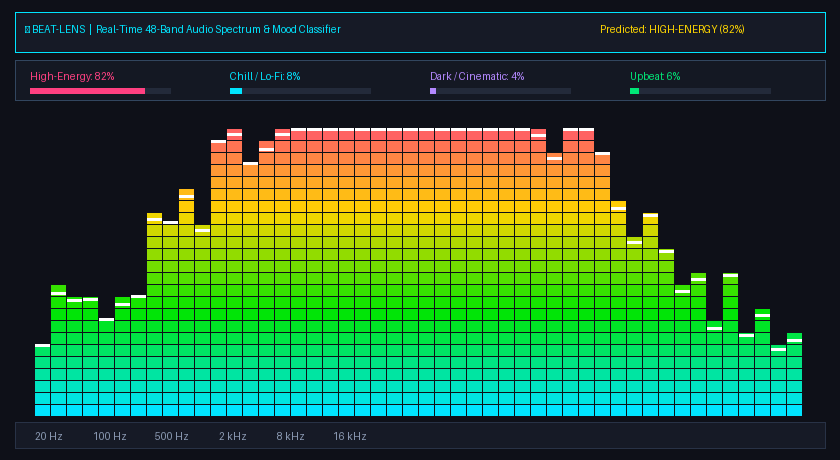

# beat-lens

> High-throughput real-time 48-band audio frequency visualizer and acoustic spectral classifier in Python.



[](https://github.com/omchandra0907-jpg/beat-lens/actions/workflows/ci.yml)
[](https://opensource.org/licenses/MIT)
[](https://www.python.org/)

> **Live Interactive Web Demo:** [https://omchandra0907-jpg.github.io/beat-lens/](https://omchandra0907-jpg.github.io/beat-lens/)

---

## Architectural Overview

`beat-lens` is a dual-rate acoustic signal processing pipeline built for sub-millisecond audio frequency decomposition and spectral classification. It combines a continuous circular ring buffer with real FFT frequency analysis and high-dimensional acoustic feature extraction.

### Core Data Structures & Engine Design

- **Lock-Free Circular Ring Buffer (`AudioRingBuffer`)**:
  - Implements a contiguous NumPy ring buffer (`44100 * 3` samples) with atomic read/write head tracking.
  - Supports asynchronous ingestion from live low-latency microphone streams (`sounddevice`) or chunked audio file feeds (`wave`) without thread blocking or memory reallocation in the hot path.

- **Logarithmic 48-Band Frequency Analyzer (`SpectrumAnalyzer`)**:
  - **Windowing:** Applies a 2048-sample Hann window (`w[n] = 0.5 * (1 - cos(2pi * n / N))`) to suppress spectral leakage across slice boundaries.
  - **rFFT Decomposition:** Computes one-sided Real Fast Fourier Transform magnitudes over Nyquist space ($0$ to $22.05\text{ kHz}$).
  - **Cochlear Log Binning:** Maps FFT bins into 48 logarithmically spaced frequency bands from $20\text{ Hz}$ to $16\text{ kHz}$, accurately matching human auditory perception.
  - **Ballistics Engine:** Incorporates exponential temporal smoothing with asymmetric attack/release coefficients and gravity-decay peak-hold caps.

- **Multi-Rate Acoustic Feature Extraction**:
  - **Spectral Descriptors:** Real-time computation of Spectral Centroid (brightness), Spectral Spread (bandwidth), Spectral Flux (transient detection), and Zero-Crossing Rate (percussiveness).
  - **Cepstral Analysis:** Computes 13 Mel-Frequency Cepstral Coefficients (MFCCs) via discrete cosine transform over triangular Mel-scale filterbanks.
  - **Two-Speed Threading:** The visual rendering loop executes at 60 Hz on the main thread while acoustic descriptors feed classification routines asynchronously at 2 Hz.

- **Acoustic Profile Categories**:
  - `High-Energy`: High spectral flux, intense sub-bass transients, elevated centroid.
  - `Chill / Lo-Fi`: Warm low-pass rolloff, restrained spectral flux, compressed dynamic range.
  - `Dark / Cinematic`: Sustained low-frequency resonant drones, low centroid, wide harmonic spread.
  - `Upbeat`: Vibrant upper-mid presence, crisp transients, balanced dynamic profile.

---

## Quickstart

### Installation

```bash
git clone https://github.com/omchandra0907-jpg/beat-lens.git
cd beat-lens
pip install -e .
```

### Zero-Setup Demo Mode

Launch the ANSI TrueColor terminal visualizer immediately with the bundled synthwave audio loop:

```bash
beat-lens --demo
```

### Analyze Live Microphone Input

```bash
beat-lens
```

### Analyze a Local Audio File

```bash
beat-lens path/to/recording.wav
```

---

## Verification & Testing

Run the full pytest test suite verifying FFT peak detection accuracy, ring buffer boundary wrapping, and acoustic descriptor extraction:

```bash
pytest tests/
```

---

## Technical Specifications

| Parameter | Specification |
|---|---|
| **Sampling Rate** | 44,100 Hz (16-bit PCM standard) |
| **FFT Window Size** | 2048 samples (~46.4 ms temporal resolution) |
| **Window Function** | Hann (`numpy.hanning`) |
| **Frequency Bands** | 48 logarithmic bands ($20\text{ Hz}$ – $16\text{ kHz}$) |
| **Buffer Architecture** | 3-second continuous circular NumPy ring buffer |
| **Terminal Output** | 24-bit TrueColor ANSI escape sequences with peak-hold physics |
| **Web Output** | Web Audio API `AnalyserNode` + Canvas 2D + Web Audio Synth |

---

## License

Distributed under the MIT License. Developed by [Om Chandra](https://github.com/omchandra0907-jpg).
